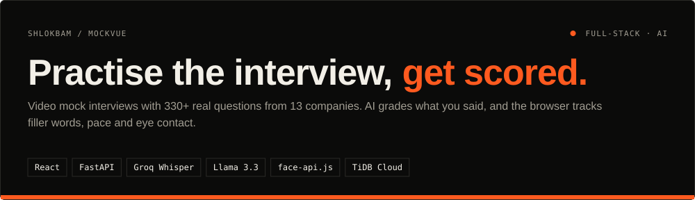
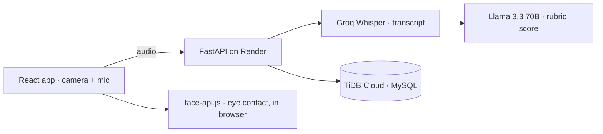
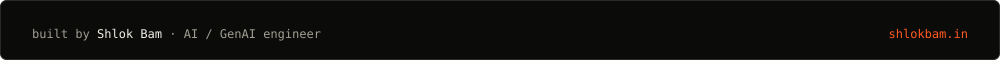

<div align="center">




<a href="https://mock-vue.vercel.app">Live app</a> · <a href="#what-it-does">What it does</a> · <a href="#how-it-works">How it works</a> · <a href="#quickstart">Quickstart</a> · <a href="#design-decisions">Decisions</a> · <a href="docs/DETAILS.md">Full notes</a>

</div>

## In one minute

- **Problem:** practising for interviews alone gives no feedback, and mock interviews with people are hard to schedule.
- **What this does:** pick a company and role, answer on camera, and get a report: an AI grade of your answer's content, plus filler words, speaking pace, silences and eye contact.
- **Result:** 330+ questions across 13 companies (Google, Amazon, Microsoft, Adobe, Meta, Netflix, Flipkart and more), with session history and score trends saved per user. It runs on free tiers end to end.

## What it does

| Feature | How |
| :--- | :--- |
| Question bank | 330+ questions, 5 roles for each of 13 companies, loaded from the database so new ones appear without a deploy |
| Answer grading | Your audio is transcribed with Groq Whisper, then graded by Llama 3.3 70B against a JSON rubric |
| Delivery metrics | Filler words, words per minute and pauses over 3 s, folded into a confidence score |
| Eye contact | Gaze tracking in the browser with `face-api.js`; video never leaves your device |
| History | Sessions, answers and score trends stored in TiDB Cloud |
| Cold starts | A wake-up screen while the free Render backend boots |

## How it works



| Part | What it does |
| :--- | :--- |
| `backend/routers/answers.py` | Transcribes and grades each answer, computes delivery metrics |
| `backend/routers/sessions.py` | Interview sessions and searchable history |
| `backend/seed_db.py` | Loads the 330+ questions without wiping user results |
| `frontend/src/pages/Interview.jsx` | Recording, timer and live eye-contact overlay |
| `frontend/src/pages/FeedbackReport.jsx` | The per-answer report |

## Quickstart

```bash
# backend · needs DATABASE_URL (MySQL / TiDB), SECRET_KEY, ALGORITHM=HS256 and a Groq key
cd backend && python -m venv venv && source venv/bin/activate
pip install -r requirements.txt
python3 seed_db.py            # load the question bank
uvicorn main:app --reload

# frontend · set VITE_API_BASE_URL to the backend URL
cd frontend && npm install && npm run dev
```

## Design decisions

- **Score the content with an LLM, the delivery with code.** Filler words and pace are counted directly, which is cheaper and more consistent than asking a model.
- **Eye tracking stays in the browser.** Only audio is uploaded, so the video of your face is never stored.
- **Questions are data.** Companies and roles come from the database, so the question bank grows with a seed script, not a release.

## Limits & roadmap

- [ ] ⚠️ Answer grading calls `llama-3.3-70b-versatile`, which Groq retired in October 2026; move it to a current model with a fallback chain
- [ ] Calibrate the AI grades against human-scored answers

---

<div align="center">

<a href="https://shlokbam.in"></a>

<a href="https://shlokbam.in">shlokbam.in</a> · <a href="https://www.linkedin.com/in/shlokbam/">LinkedIn</a> · <a href="https://github.com/shlokbam">More projects</a>

</div>
